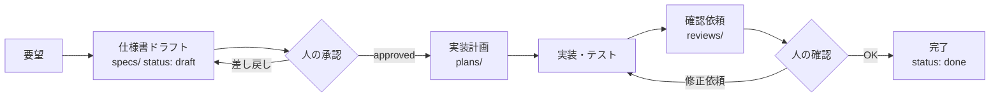

# ドキュメント

AI駆動開発のためのドキュメント置き場です。人と AI の双方が読み書きします。

## ディレクトリ

| 場所 | 内容 | 主な書き手 | 人の役割 |
| --- | --- | --- | --- |
| [backlog.md](backlog.md) | **バックログ**（残課題・機能・改善・バグと状態） | 人 + AI | **受付箱に書く・次の3件を選ぶ** |
| [questions.md](questions.md) | **判断待ちボード**（確認事項・決定の記録） | AI が質問を追加 | **回答する** |
| [project/](project/) | プロジェクト概要・用語集・アーキテクチャ | 人 + AI | 方針を決める |
| [specs/](specs/) | 機能仕様書 | AI がドラフト | **承認する（ゲート1）** |
| [plans/](plans/) | 実装計画・タスク分解 | AI | 必要なら確認 |
| [reviews/](reviews/) | 確認依頼・レビュー記録 | AI が依頼 | **確認・判断する（ゲート2）** |
| [decisions/](decisions/) | ADR（設計判断の記録） | 人 + AI | 判断を記録する |

## ワークフロー



どの段階でも、AI が判断できないことは [questions.md](questions.md) に質問として追加されます。
人が `回答:` を書いて「回答を反映して」と伝えると、AI が仕様書などに反映し「決定済み」に移します。

## 番号とファイル名

仕様・計画・レビューは同じ番号で紐づけます。

```
docs/specs/001-post-tweet.md
docs/plans/001-post-tweet.md
docs/reviews/001-post-tweet.md
```

## ステータス

仕様書の frontmatter `status` は以下の順に進みます。

| status | 意味 | 変更できる人 |
| --- | --- | --- |
| `draft` | AI が作成・編集中 | AI / 人 |
| `review` | 人の承認待ち | AI / 人 |
| `approved` | 承認済み・実装可 | **人のみ** |
| `done` | 実装完了・確認済み | **人のみ** |
| `rejected` | 見送り | 人のみ |
