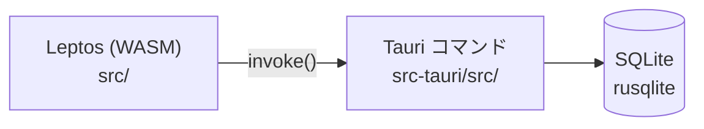

# アーキテクチャ

## 全体構成

| レイヤ | 場所 | 責務 |
| --- | --- | --- |
| UI | `src/app.rs` ほか | 画面描画・入力。Tauri コマンドを `invoke` で呼ぶ |
| コマンド | `src-tauri/src/lib.rs` | `#[tauri::command]` でフロントに API を公開 |
| 永続化 | `src-tauri/src/db.rs` | rusqlite で SQLite を読み書き。ファイルは `%APPDATA%\com.hikou.x-clone\x-clone.sqlite`（Q-012） |
| AI | `src-tauri/src/llm/`, `classify.rs`, `reply.rs` | `LlmProvider` トレイトの裏で Claude API を呼ぶ（ADR-002）。分類と AI リプライ |
| backend | `backend/` | 未使用（将来のサーバー用途を想定） |

## ビルドの流れ

- 開発: `cargo tauri dev` → `trunk serve --port 1421` でフロントを配信し、Tauri がそれを読み込む
- 本番: `trunk build` で `dist/` を生成 → Tauri がバンドル

## データモデル

定義の正本は `src-tauri/src/db.rs` の `MIGRATIONS`（DB の版ごとの更新の一覧）。

| テーブル | 主な列 | 説明 |
| --- | --- | --- |
| `posts` | `id`, `body`, `created_at`, `classify_status`（pending / done / failed）, `classify_error` | ユーザーのポスト |
| `tasks` | `id`, `post_id`（→ posts, CASCADE）, `kind`, `title`, `target`, `action`, `status`（open / done）, `created_at`, `completed_at` | ポストから AI が起こしたタスク |
| `replies` | `id`, `post_id`（→ posts, CASCADE）, `author`（`ai`）, `body`, `sources`（出典の JSON 配列）, `model`, `status`（pending / done / failed）, `error`, `created_at` | ポストへのリプライ。AI のリプライはポストごとに1件 |

- **DB の版管理（マイグレーション）**: `PRAGMA user_version` に版数を記録し、起動時に足りない版だけを当てる。テーブルや列を増やすときは `MIGRATIONS` の末尾に版を足す（既存の版は変えない）。

  | 版 | 内容 | 仕様 |
  | --- | --- | --- |
  | 1 | posts / tasks | 001 |
  | 2 | `tasks.completed_at` | 002 |
  | 3 | `replies` | 003 |

- 種別（`kind`）の定義（表示名・色・分類の基準・リプライでの答え方）は `src-tauri/src/kind.rs` の `KINDS` にまとめてある。増やすときはここだけ直す。
- 起動時に `pending` のまま残っているポスト・リプライ（前回の終了で中断されたもの）は `failed` にする。

## AI の設定（`.env`）

| 変数 | 既定値 | 用途 |
| --- | --- | --- |
| `ANTHROPIC_API_KEY` | なし | Claude API のキー |
| `CLAUDE_MODEL` | `claude-haiku-4-5` | 分類に使うモデル |
| `CLAUDE_REPLY_MODEL` | `claude-haiku-4-5` | リプライに使うモデル。調査のポストでは Web 検索（最大3回）を使う |

## Tauri コマンド一覧

引数名は snake_case（例: `before_id`）。

| コマンド名 | 引数 | 戻り値 | 仕様書 |
| --- | --- | --- | --- |
| `create_post` | `body: String` | `Post`（保存して即返す。分類は裏で開始） | [001](../specs/001-post-and-classify.md) |
| `list_timeline` | `limit: u32`, `before_id: Option<i64>` | `Vec<PostWithTasks>`（新しい順。タスクとリプライを含む） | [001](../specs/001-post-and-classify.md) |
| `retry_classification` | `post_id: i64` | `()` | [001](../specs/001-post-and-classify.md) |
| `list_kinds` | なし | `Vec<KindInfo>`（種別・表示名・色） | [001](../specs/001-post-and-classify.md)（実装時に追加） |
| `set_task_status` | `task_id: i64`, `status: "open" \| "done"` | `PostWithTasks` | [002](../specs/002-complete-task.md) |
| `request_ai_reply` | `post_id: i64` | `()`（受け付けてすぐ返す。生成は裏で行う） | [003](../specs/003-ai-reply.md) |

プラグインのコマンド: `plugin:opener|open_url`（出典の URL を既定のブラウザで開く）

## イベント

| イベント名 | payload | いつ |
| --- | --- | --- |
| `post-updated` | `PostWithTasks` | 分類・AI リプライが終わったとき（成功・失敗とも）。仕様003 で `post-classified` から改名 |
