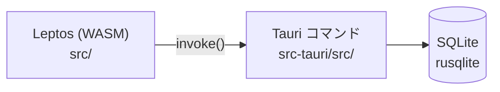

# アーキテクチャ

## 全体構成

| レイヤ | 場所 | 責務 |
| --- | --- | --- |
| UI | `src/app.rs` ほか | 画面描画・入力。Tauri コマンドを `invoke` で呼ぶ |
| コマンド | `src-tauri/src/lib.rs` | `#[tauri::command]` でフロントに API を公開 |
| 永続化 | `src-tauri/src/db.rs` | rusqlite で SQLite を読み書き。ファイルは `%APPDATA%\com.hikou.x-clone\x-clone.sqlite`（Q-012） |
| AI | `src-tauri/src/llm/` | `LlmProvider` トレイトの裏で Claude API を呼ぶ（ADR-002） |
| backend | `backend/` | 未使用（将来のサーバー用途を想定） |

## ビルドの流れ

- 開発: `cargo tauri dev` → `trunk serve --port 1421` でフロントを配信し、Tauri がそれを読み込む
- 本番: `trunk build` で `dist/` を生成 → Tauri がバンドル

## データモデル

定義の正本は `src-tauri/src/db.rs` の `SCHEMA`。

| テーブル | 主な列 | 説明 |
| --- | --- | --- |
| `posts` | `id`, `body`, `created_at`, `classify_status`（pending / done / failed）, `classify_error` | ユーザーのポスト |
| `tasks` | `id`, `post_id`（→ posts, CASCADE）, `kind`, `title`, `target`, `action`, `status`（open / done）, `created_at` | ポストから AI が起こしたタスク |

- 種別（`kind`）の定義は `src-tauri/src/kind.rs` の `KINDS` にまとめてある。増やすときはここだけ直す。
- 起動時に `pending` のまま残っているポスト（前回の終了で分類が中断されたもの）は `failed` にする。

## Tauri コマンド一覧

引数名は snake_case（例: `before_id`）。

| コマンド名 | 引数 | 戻り値 | 仕様書 |
| --- | --- | --- | --- |
| `create_post` | `body: String` | `Post`（保存して即返す。分類は裏で開始） | [001](../specs/001-post-and-classify.md) |
| `list_timeline` | `limit: u32`, `before_id: Option<i64>` | `Vec<PostWithTasks>`（新しい順） | [001](../specs/001-post-and-classify.md) |
| `retry_classification` | `post_id: i64` | `()` | [001](../specs/001-post-and-classify.md) |
| `list_kinds` | なし | `Vec<KindInfo>`（種別・表示名・色） | [001](../specs/001-post-and-classify.md)（実装時に追加） |

## イベント

| イベント名 | payload | いつ |
| --- | --- | --- |
| `post-classified` | `PostWithTasks` | 分類が終わったとき（成功・失敗とも） |
