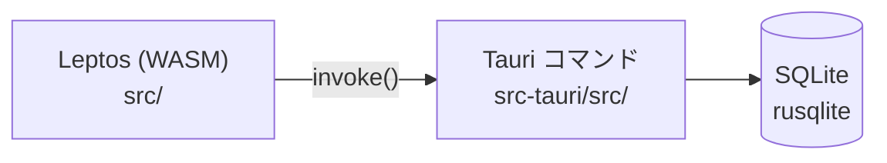

# アーキテクチャ

## 全体構成

| レイヤ | 場所 | 責務 |
| --- | --- | --- |
| UI | `src/app.rs` ほか | 画面描画・入力。Tauri コマンドを `invoke` で呼ぶ |
| コマンド | `src-tauri/src/lib.rs` | `#[tauri::command]` でフロントに API を公開 |
| 永続化 | `src-tauri/` | rusqlite で SQLite を読み書き |
| backend | `backend/` | 未使用（将来のサーバー用途を想定） |

## ビルドの流れ

- 開発: `cargo tauri dev` → `trunk serve --port 1421` でフロントを配信し、Tauri がそれを読み込む
- 本番: `trunk build` で `dist/` を生成 → Tauri がバンドル

## データモデル

<!-- テーブル定義が決まったらここに書く。変更時は仕様書・ADR と合わせて更新 -->

## Tauri コマンド一覧

| コマンド名 | 引数 | 戻り値 | 仕様書 |
| --- | --- | --- | --- |
| | | | |
